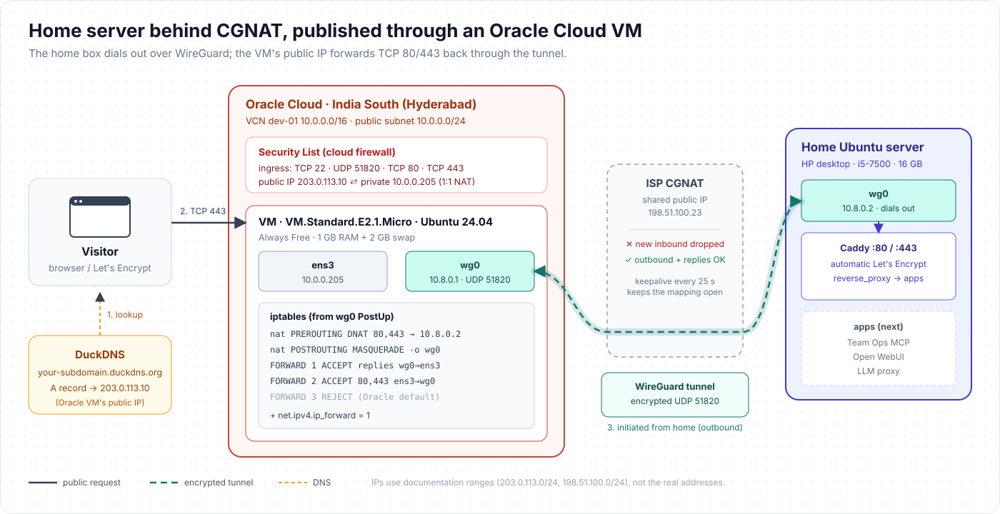
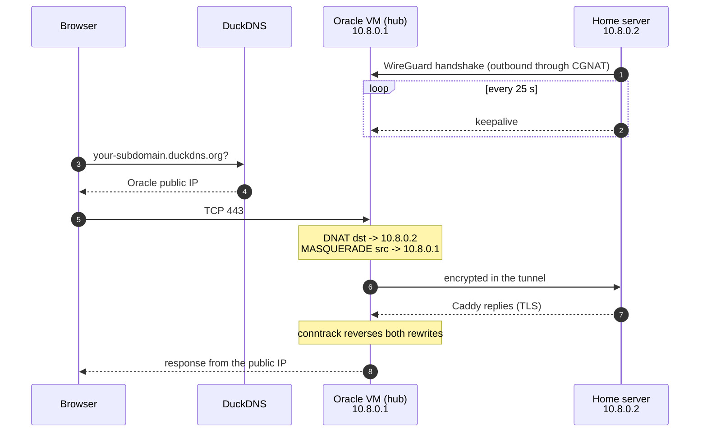
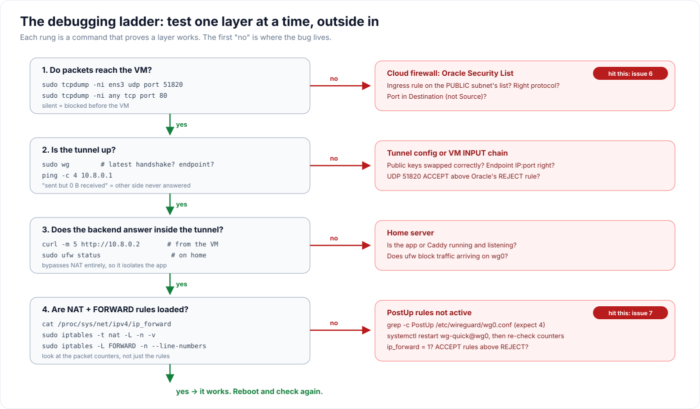
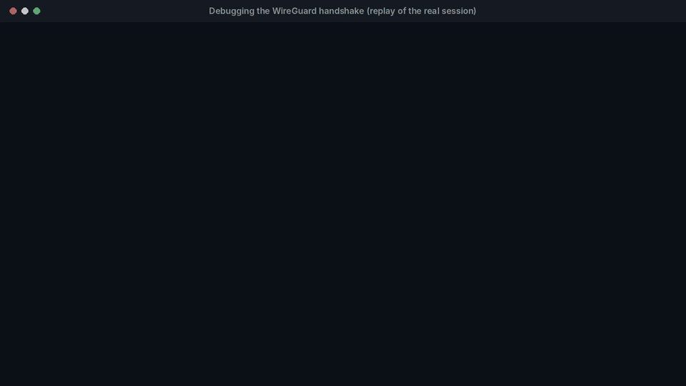
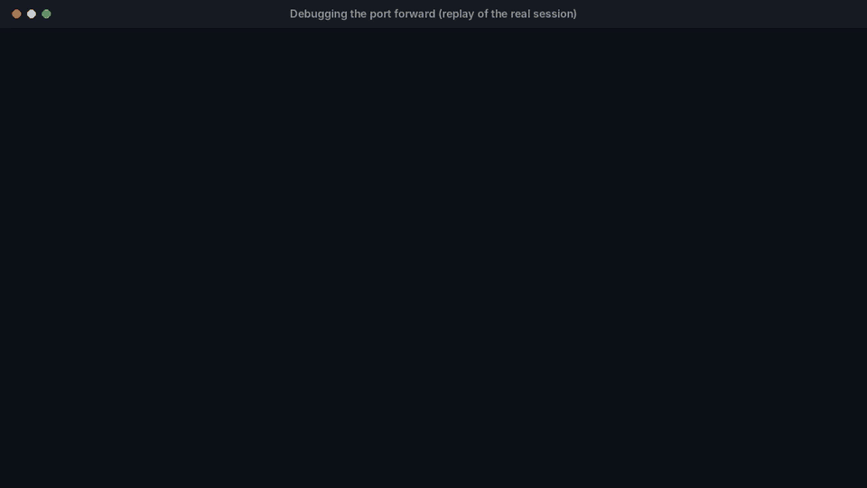

# A public IP for a home server behind CGNAT, for free

My ISP puts my home connection behind **Carrier-Grade NAT**, so nothing on the internet can connect to my home Ubuntu server, and router port forwarding does nothing. A static IP from the ISP would cost around Rs. 18,400 a month.

This repo documents how I got around that with an **Oracle Cloud Always Free VM**, a **hand-configured WireGuard tunnel**, **iptables NAT** and **Caddy**. A free DuckDNS domain now serves HTTPS from my home machine with a valid Let's Encrypt certificate, and the setup survives reboots. I built it step by step on 23 November 2026 and wrote down every problem I hit along the way.


*50-second walkthrough. MP4 version: [demo/explainer.mp4](demo/explainer.mp4)*

## Architecture



The home server **dials out** to the Oracle VM over WireGuard. CGNAT allows outbound connections, and a keepalive every 25 seconds keeps the mapping open. The VM receives public traffic on TCP 80/443, rewrites the destination to the home server's tunnel IP (DNAT), rewrites the source so replies come back through the tunnel (MASQUERADE), and sends it down the tunnel.



## Stack

| Piece | Choice | Role |
|---|---|---|
| Hub | Oracle Cloud `VM.Standard.E2.1.Micro`, Ubuntu 24.04, Hyderabad | Real public IP, front door |
| Tunnel | WireGuard (`wg-quick`), plain config, no Tailscale | Encrypted link that starts from inside CGNAT |
| Forwarding | `iptables` DNAT + MASQUERADE + FORWARD rules in `PostUp` | Sends public 80/443 to the home server |
| DNS | DuckDNS | Free subdomain pointing at the hub |
| HTTPS | Caddy | Automatic Let's Encrypt certificates on the home server |
| Home | Ubuntu on an HP desktop (i5-7500, 16 GB) | Runs the actual services |

## Repository layout

```
.
├── docs/                     step-by-step write-up, read in order
│   ├── 01-the-problem-cgnat.md
│   ├── 02-oracle-cloud-setup.md
│   ├── 03-wireguard-tunnel.md
│   ├── 04-port-forwarding.md
│   ├── 05-https-with-caddy.md
│   ├── 06-troubleshooting-journal.md   every issue, the evidence, the fix
│   ├── 07-security-notes.md
│   └── 08-operations.md                health checks, reboot test, roadmap
├── configs/
│   ├── oracle-vm/            wg0.conf.example, sysctl forwarding
│   ├── home-server/          wg0.conf.example, Caddyfile
│   └── oracle-cloud/         Security List ingress rules
├── scripts/                  setup and verification scripts (shellcheck clean)
├── diagrams/                 SVG diagrams
├── demo/                     explainer video + terminal replays (MP4 and GIF)
└── tools/                    Python that generates the videos and one diagram
```

## Quick start

Generate keys and configs with the scripts, or follow the docs by hand.

```bash
# 1. Home server: install WireGuard and print the home public key
sudo apt install -y wireguard
sudo ./scripts/gen-keys.sh home

# 2. Oracle VM: install, enable forwarding, open UDP 51820, write wg0.conf with the NAT rules.
#    Prints the hub public key at the end.
sudo HOME_PUBKEY='<home public key>' ./scripts/setup-hub.sh

# 3. Home server: write wg0.conf (reuses the key from step 1) and start the tunnel
sudo HUB_PUBKEY='<hub public key>' HUB_ENDPOINT='<oracle-public-ip>:51820' ./scripts/setup-home.sh

# 4. Oracle console: Security List ingress UDP 51820, TCP 80, TCP 443

# 5. Check every layer
sudo ./scripts/verify-hub.sh
sudo DOMAIN=your-subdomain.duckdns.org ./scripts/verify-home.sh
```

The scripts never print or copy private keys; they read them from `/etc/wireguard/*.key` when writing the config.

## What went wrong, and how I found it



| # | Problem | How I found the cause | Fix |
|---|---|---|---|
| 1 | `Out of capacity` for A1.Flex (Hyderabad has one AD) | Error message, smaller sizes failed too | Used E2.1.Micro, saved A1 as a Terraform stack to retry |
| 2 | `Shape ... is not valid for image` | Image had switched to aarch64 | Pick shape first, then the x86 image |
| 3 | Public IPv4 toggle locked | Needed an existing public subnet | Built the network with the VCN wizard first |
| 6 | No WireGuard handshake | Home: `0 B received`; hub: no endpoint; `tcpdump` silent | Security List had no UDP 51820 |
| 7 | Public port timed out | `curl 10.8.0.2` worked, NAT table empty, FORWARD only REJECT | `PostUp` rules weren't loaded; reloaded the config |
| 9 | DuckDNS token visible in a screenshot | Spotted before publishing | Regenerated the token |

Full details, with the actual command output: [docs/06-troubleshooting-journal.md](docs/06-troubleshooting-journal.md)

| Handshake debugging | Port-forward debugging |
|---|---|
|  |  |

## What I learned

- **CGNAT only blocks inbound.** Any design where the inside machine starts the connection gets through, which is how Tailscale, Cloudflare Tunnel and this setup all work.
- **Cloud VMs have two firewalls.** Oracle's Security List and the image's own iptables both have to allow a port, and Oracle's Ubuntu image REJECTs by default in both INPUT and FORWARD.
- **DNAT alone isn't enough.** Without MASQUERADE the home server answers through the wrong path and the connection dies.
- **`tcpdump` settles arguments fast.** Silent on the receiving interface means the problem is upstream; packets arriving means it's local.
- **A config file isn't the running config.** `iptables -L -n -v` counters and `wg show` say what the kernel actually has.
- **Public ports get scanned within minutes.** The DNAT counter moved before I'd tested anything.

## Docs

1. [The problem: CGNAT](docs/01-the-problem-cgnat.md)
2. [Oracle Cloud setup](docs/02-oracle-cloud-setup.md)
3. [The WireGuard tunnel](docs/03-wireguard-tunnel.md)
4. [Port forwarding with iptables](docs/04-port-forwarding.md)
5. [HTTPS with Caddy](docs/05-https-with-caddy.md)
6. [Troubleshooting journal](docs/06-troubleshooting-journal.md)
7. [Security notes](docs/07-security-notes.md)
8. [Operations and roadmap](docs/08-operations.md)

## Next

- Add my laptop and phone as WireGuard peers for private access from anywhere ([roadmap](docs/08-operations.md#roadmap))
- Put real services behind Caddy with authentication
- `ufw` on the home server, fail2ban, unattended upgrades
- Terraform for the Oracle resources

## A note on the values in this repo

IP addresses use the documentation ranges `203.0.113.0/24`, `198.51.100.0/24` and `192.0.2.0/24`, and keys, tokens and the real domain are placeholders. Nothing here points at my actual machines.

## License

[MIT](LICENSE)
