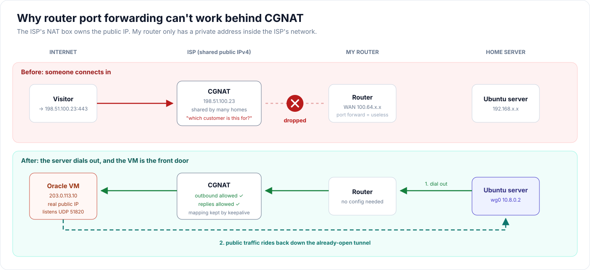

# 1. The problem: a home server behind CGNAT



## What I wanted

My home Ubuntu server (an old HP office desktop with an i5-7500 and 16 GB of RAM) runs things I want to reach from anywhere: demos, small APIs, later an LLM endpoint. On a normal connection I would forward a port on the router and be done.

## Why that doesn't work here

My ISP uses **Carrier-Grade NAT (CGNAT)**. Many homes share one public IPv4 address that belongs to the ISP, not to me. My router's "WAN IP" is itself a private address inside the ISP's network.

- **Outbound works.** When my server opens a connection, the ISP's NAT box remembers it and lets the replies back in.
- **Inbound fails.** When someone on the internet connects to the shared public IP, the ISP's NAT box has no idea which of its thousands of customers should get the packet, so it drops it.
- **Port forwarding on my router is useless.** The router sits *behind* the ISP's NAT, which I can't configure.

### How to tell if you're behind CGNAT

Compare the WAN IP shown on your router's admin page with what the internet sees:

```bash
curl ifconfig.me
```

If they differ, or the router shows an address in `100.64.0.0/10` (100.64.x.x to 100.127.x.x), you're behind CGNAT.

## Options I considered

| Option | Cost | Why I did or didn't pick it |
|---|---|---|
| Static IP from the ISP | About Rs. 18,400/month in my case (only on one specific SLT fibre plan, plus tax) | Far too expensive for a homelab |
| Tailscale / Cloudflare Tunnel | Free | Easiest, but I wanted to learn the networking myself rather than use a managed service |
| **Cloud VM with a public IP + WireGuard** | **Free** (Oracle Cloud Always Free) | Real public IP, full control over the setup, and it teaches routing, NAT and firewalls |

## The idea

Rent a free cloud VM that *does* have a public IP and let it act as the front door.

1. The home server **dials out** to the VM over WireGuard. Outbound is allowed, so CGNAT is not a problem.
2. A keepalive packet every 25 seconds keeps that connection open through the ISP's NAT.
3. The VM receives public traffic on ports 80/443 and **forwards it back through the tunnel** to the home server.

From the outside, the VM's public IP behaves like my home server's own public IP.

Next: [2. Oracle Cloud setup](02-oracle-cloud-setup.md)
