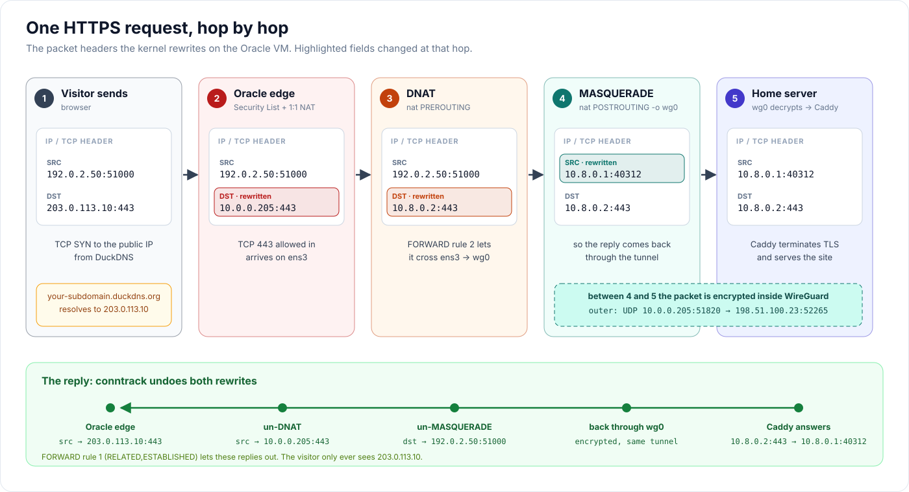

# 4. Port forwarding: making the public IP point home



With the tunnel up, the hub needs to pass public traffic on TCP 80 and 443 into the tunnel. That takes three pieces: IP forwarding, NAT rules, and FORWARD-chain rules.

## 4.1 Turn the VM into a router

```bash
echo 'net.ipv4.ip_forward = 1' | sudo tee /etc/sysctl.d/99-wireguard-forwarding.conf
sudo sysctl --system
cat /proc/sys/net/ipv4/ip_forward    # should print 1
```

By default Linux drops packets that aren't addressed to itself. `ip_forward = 1` lets it pass packets between `ens3` (internet) and `wg0` (tunnel). Writing it to `/etc/sysctl.d/` makes it survive reboots.

## 4.2 NAT and filter rules in the WireGuard config

I put the iptables rules in `PostUp`/`PostDown` in the hub's `wg0.conf`, so they exist exactly while the tunnel exists. The full file is [configs/oracle-vm/wg0.conf.example](../configs/oracle-vm/wg0.conf.example).

```ini
PostUp = iptables -t nat -A PREROUTING -i ens3 -p tcp -m multiport --dports 80,443 -j DNAT --to-destination 10.8.0.2
PostUp = iptables -t nat -A POSTROUTING -o wg0 -j MASQUERADE
PostUp = iptables -I FORWARD 1 -i ens3 -o wg0 -p tcp -m multiport --dports 80,443 -j ACCEPT
PostUp = iptables -I FORWARD 1 -i wg0 -o ens3 -m state --state RELATED,ESTABLISHED -j ACCEPT
```

| Rule | Table / chain | What it does |
|---|---|---|
| DNAT | `nat` / `PREROUTING` | Traffic arriving on `ens3` for TCP 80/443 gets its **destination** rewritten to `10.8.0.2`. This is the actual port forward. |
| MASQUERADE | `nat` / `POSTROUTING` | Traffic leaving into `wg0` gets its **source** rewritten to `10.8.0.1`. Without it, the home server would answer the visitor directly through my home ISP, from an address the visitor never contacted, and the connection would break. |
| FORWARD accept (new) | `filter` / `FORWARD` | Lets new 80/443 connections cross from internet to tunnel. `-I FORWARD 1` places it above Oracle's REJECT rule. |
| FORWARD accept (replies) | `filter` / `FORWARD` | Lets only replies to existing connections go back out. The home server cannot start new connections through the hub. |

`PostDown` repeats each rule with `-D` to delete it when the tunnel stops.

The order a packet meets these rules:

```
ens3 in -> PREROUTING (DNAT: dst -> 10.8.0.2) -> routing decision -> FORWARD (ACCEPT)
        -> POSTROUTING (MASQUERADE: src -> 10.8.0.1) -> wg0 out -> encrypted to home
```

Forwarded traffic never touches the `INPUT` chain, so 80/443 need no INPUT rules on the VM. They do need ingress rules in the Oracle Security List.

## 4.3 Security List

Two more ingress rules: TCP 80 and TCP 443 from `0.0.0.0/0`. I first typed `40,443` into one field. One rule per port is easier to read and harder to get wrong.

## 4.4 Test

On the home server:

```bash
mkdir -p ~/webtest && cd ~/webtest
echo "Hello from my home Ubuntu box via Oracle!" > index.html
sudo python3 -m http.server 80
```

Then open `http://<ORACLE_PUBLIC_IP>` from a phone on mobile data.

The first attempt timed out. The rules weren't loaded at all: the NAT table was empty and the FORWARD chain only held Oracle's REJECT rule. Once `wg-quick@wg0` was running the config with the `PostUp` lines, the page loaded. That debugging session is [troubleshooting, issue 7](06-troubleshooting-journal.md#7-port-forward-times-out-postup-rules-never-loaded).

Stop the Python server afterwards (Ctrl+C). A root web server serving a folder is not something to leave running.

## 4.5 Proof that it survives a reboot

After rebooting both machines:

```
$ sudo iptables -t nat -L -n -v
Chain PREROUTING (policy ACCEPT 6 packets, 336 bytes)
 pkts bytes target  prot opt in    out  source     destination
    2    93 DNAT    6    --  ens3  *    0.0.0.0/0  0.0.0.0/0   multiport dports 80,443 to:10.8.0.2

Chain POSTROUTING (policy ACCEPT 280 packets, 20807 bytes)
 pkts bytes target      prot opt in  out   source     destination
    3   177 MASQUERADE  0    --  *   wg0   0.0.0.0/0  0.0.0.0/0

$ sudo iptables -L FORWARD -n --line-numbers
1    ACCEPT  0  --  0.0.0.0/0  0.0.0.0/0  state RELATED,ESTABLISHED
2    ACCEPT  6  --  0.0.0.0/0  0.0.0.0/0  multiport dports 80,443
3    REJECT  0  --  0.0.0.0/0  0.0.0.0/0  reject-with icmp-host-prohibited
```

The `-v` flag shows the interface columns (`in ens3`, `out wg0`), which confirms the rules only touch the right traffic. The `2` packets counted on the DNAT rule arrived within minutes of the reboot, before I had tested anything. Internet scanners find open ports very quickly.

Next: [5. HTTPS with Caddy](05-https-with-caddy.md)
