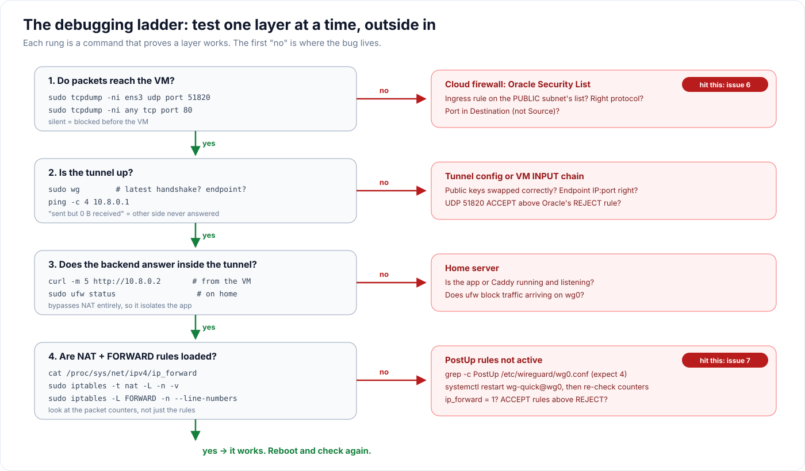

# 6. Troubleshooting journal

Every problem I hit during the build, in the order it happened, with the evidence that pointed to the cause.



The method that worked every time was to test one layer at a time, from the outside in, and let a tool prove each layer before moving on:

| Layer | Tool | Question it answers |
|---|---|---|
| Cloud firewall | `tcpdump` on the VM | Do packets reach the VM at all? |
| Tunnel | `wg`, `ping 10.8.0.x` | Did the handshake happen? Do packets cross? |
| VM firewall / routing | `iptables -L -n -v`, `/proc/sys/net/ipv4/ip_forward` | Are the rules loaded, in the right order, and are their counters moving? |
| Backend | `curl http://10.8.0.2` from the VM | Is the app answering inside the tunnel? |

| # | Issue | Area |
|---|---|---|
| 1 | [A1.Flex out of capacity](#1-a1flex-out-of-capacity) | Oracle compute |
| 2 | [Shape not valid for image](#2-shape-not-valid-for-image) | Oracle compute |
| 3 | [Public IPv4 toggle locked](#3-public-ipv4-toggle-locked-in-the-instance-form) | Oracle networking |
| 4 | [Manual VCN form asks for CIDR blocks](#4-manual-create-vcn-form-no-matches-found) | Oracle networking |
| 5 | [SSH: hostname contains invalid characters](#5-ssh-hostname-contains-invalid-characters) | Client |
| 6 | [WireGuard: no handshake](#6-wireguard-no-handshake-home-sends-vm-never-receives) | Cloud firewall |
| 7 | [Port forward times out](#7-port-forward-times-out-postup-rules-never-loaded) | VM NAT / iptables |
| 8 | [Port typo in the Security List](#8-port-typo-in-the-security-list) | Cloud firewall |
| 9 | [DuckDNS token visible in a screenshot](#9-duckdns-token-visible-in-a-screenshot) | Security |
| 10 | [Budget period didn't match the trial](#10-monthly-budget-didnt-match-the-trial-window) | Billing |

## 1. A1.Flex out of capacity

**Symptom.** Creating the 4 OCPU / 24 GB Arm instance failed:

```
API Error: Out of capacity for shape VM.Standard.A1.Flex in availability domain AD-1.
Create the instance in a different availability domain or try again later.
```

Dropping to 2 OCPU / 12 GB gave the same error.

**Cause.** Oracle's free Arm capacity is shared by everyone and often runs out. Hyderabad has only one availability domain, so there was no other AD to try, and the home region can't be changed.

**Fix.**
- Saved the A1 configuration as a **Resource Manager stack** (Terraform) so I can retry with one click at off-peak hours.
- Built the project on the always-available `VM.Standard.E2.1.Micro` instead, with a 50 GB boot volume to leave storage for a future A1.
- Retry automatically every 15 minutes with [`scripts/oracle-a1-retry.sh`](../scripts/oracle-a1-retry.sh) (OCI CLI), starting at 1 OCPU / 6 GB. Even 1 OCPU / 6 GB was out of capacity at 5:30 AM local time on 24 Nov.

**Lesson.** Always Free capacity isn't guaranteed. Design the setup so the hub can be small: a WireGuard relay barely uses CPU.

## 2. Shape not valid for image

**Symptom.** After switching from A1 to E2.1.Micro:

```
API Error: Shape VM.Standard.E2.1.Micro is not valid for image ocid1.image.oc1.ap-hyderabad-1.aaaa...
```

**Cause.** When I picked the Arm shape, Oracle had swapped the image to the **aarch64** build of Ubuntu. E2.1.Micro is an **x86** AMD shape and needs the x86 build.

**Fix.** Set the shape first, then **Change image → Canonical Ubuntu 24.04** again so Oracle picks the build that matches the CPU architecture.

**Lesson.** CPU architecture is part of the image. Change the shape before the image, not after.

## 3. Public IPv4 toggle locked in the instance form

**Symptom.** In the instance's networking section, "Automatically assign public IPv4 address" was greyed out with *"You must select a public subnet to assign a public IPv4 address"*, even with "Create new virtual cloud network" selected.

**Cause.** The inline network creation in the instance form doesn't count as a public subnet until it exists.

**Fix.** Created the network separately with the **VCN wizard** ("Create VCN with Internet Connectivity"), then chose *Select existing VCN* → `dev-01` and *Select existing subnet* → **public subnet-dev-01** in the instance form. The toggle unlocked.

**Fallback (not needed).** An instance created without a public IP can get one later under Attached VNICs → IPv4 addresses → Edit → Ephemeral public IP.

## 4. Manual "Create VCN" form: "No matches found"

**Symptom.** The IPv4 CIDR dropdown showed *No matches found*.

**Cause.** That's the manual form. The dropdown expects you to type a CIDR such as `10.0.0.0/16` and press Enter. It also creates only an empty VCN, with no subnets, gateways or routes.

**Fix.** Cancelled and used **Start VCN Wizard** instead, which builds everything needed in one go.

## 5. SSH: "hostname contains invalid characters"

**Symptom.**

```
PS> ssh -i $env:USERPROFILE\.ssh\oracle_ed25519 ubuntu@<public-ip>ssh -i ... ubuntu@<ip>
hostname contains invalid characters
```

**Cause.** The template command (with the literal `<public-ip>` placeholder) and the real command were pasted together on one line.

**Fix.** Run only the real command, and quote the key path because the Windows username contains spaces:

```powershell
ssh -i "$env:USERPROFILE\.ssh\oracle_ed25519" ubuntu@<ORACLE_PUBLIC_IP>
```

## 6. WireGuard: no handshake (home sends, VM never receives)

**Symptom.** From the home server:

```
$ ping -c 4 10.8.0.1
4 packets transmitted, 0 received, 100% packet loss

$ sudo wg
peer: <hub public key>
  endpoint: <ORACLE_PUBLIC_IP>:51820
  allowed ips: 10.8.0.0/24
  transfer: 0 B received, 1.16 KiB sent       <- sending, nothing coming back
  persistent keepalive: every 25 seconds
```

On the hub, `sudo wg` showed the peer with **no `endpoint:` line** and no handshake. The hub had never received a single valid packet from home.

**Investigation.**

1. Hub config and keys matched. Not a key problem.
2. VM firewall: `sudo iptables -L INPUT -n --line-numbers` showed `ACCEPT udp dpt:51820` at position 1, above REJECT. Not the VM firewall.
3. `sudo tcpdump -ni ens3 udp port 51820` on the hub while pinging from home: **nothing at all**. The packets were dropped before reaching the VM.
4. Oracle Security List: only the three default rules (TCP 22 and two ICMP). **No UDP 51820.**

**Fix.** Added an ingress rule: stateless No, source `0.0.0.0/0`, protocol **UDP**, source port empty, destination port **51820**. The handshake happened within seconds:

```
IP <home>.52265 > 10.0.0.205.51820: UDP, length 148    handshake initiation
IP 10.0.0.205.51820 > <home>.52265: UDP, length 92     handshake response
IP <home>.52265 > 10.0.0.205.51820: UDP, length 32     first data / confirmation
IP <home>.52265 > 10.0.0.205.51820: UDP, length 128    encrypted ICMP echo
IP 10.0.0.205.51820 > <home>.52265: UDP, length 128    encrypted ICMP reply
```

**Lesson.** *Sending but receiving nothing* plus *the peer never learned an endpoint* means packets never arrived. `tcpdump` on the receiving interface decides between "blocked before the VM" and "blocked inside the VM" in seconds.

## 7. Port forward times out: PostUp rules never loaded

**Symptom.** `http://<ORACLE_PUBLIC_IP>` in the browser: `ERR_CONNECTION_TIMED_OUT`.

**Investigation, one layer at a time.**

```
# Backend through the tunnel, from the VM: works
$ curl -m 5 http://10.8.0.2
Hello from my home Ubuntu box via Oracle!

# Routing: on
$ cat /proc/sys/net/ipv4/ip_forward
1

# NAT table: EMPTY
$ sudo iptables -t nat -L -n -v
Chain PREROUTING (policy ACCEPT 0 packets, 0 bytes)
Chain POSTROUTING (policy ACCEPT 0 packets, 0 bytes)

# FORWARD chain: only Oracle's REJECT
$ sudo iptables -L FORWARD -n --line-numbers
1    REJECT  0  --  0.0.0.0/0  0.0.0.0/0  reject-with icmp-host-prohibited

# Live traffic: browser SYNs arrive, nothing goes out to wg0
$ sudo tcpdump -ni any tcp port 80
ens3  In  IP <home>.51688 > 10.0.0.205.80: Flags [S] ...
ens3  In  IP <home>.51688 > 10.0.0.205.80: Flags [S] ...   (retransmits, no reply)
```

So the Security List was fine (SYNs arrived on `ens3`), the tunnel and backend were fine (`curl` worked), but the VM had no DNAT rule, didn't know where to send the packets, and nothing was allowed through FORWARD.

**Cause.** The `PostUp` lines weren't active in the kernel. Either the rewritten `wg0.conf` hadn't been saved with them, or the service hadn't been restarted after the change. Both end the same way: the running tunnel still used the old phase 1 config.

**Fix.** Confirm the file has the rules, then reload it:

```bash
sudo grep -c PostUp /etc/wireguard/wg0.conf     # expect 4; if 0, rewrite the file
sudo systemctl restart wg-quick@wg0
sudo iptables -t nat -L -n -v                   # DNAT + MASQUERADE now present
```

After that the page loaded.

**Side note.** That `tcpdump` was full of `10.0.0.205 > 169.254.169.254.80` traffic. That's the VM talking to Oracle's internal **instance metadata service**. It's normal and unrelated.

**Lesson.** A config file on disk isn't the running config. Check what the kernel actually has (`iptables -S`, `wg show`), and watch the packet counters.

## 8. Port typo in the Security List

**Symptom.** While adding the web rule, the destination field read `40,443`.

**Fix.** Two separate rules, `80` and `443`. Oracle's examples only show single ports or ranges, and one rule per port is easier to audit.

## 9. DuckDNS token visible in a screenshot

**Issue.** A screenshot of the DuckDNS dashboard included the account token. Anyone with it can repoint every subdomain on the account, for example at a phishing page.

**Fix.** Regenerated the token ("recreate token") and kept it out of later screenshots.

**Lesson.** Before sharing a screenshot or committing a file, look for tokens, private keys, and IPs.

## 10. Monthly budget didn't match the trial window

**Issue.** The budget form defaulted to *Monthly, starting day 1*, but the trial credits ran from 23 Nov to 22 Dec. A monthly budget would reset on 1 Dec and forget the first week's spending.

**Fix.** Used a *Custom (non-recurring)* budget for exactly 23 Nov to 22 Dec at SGD 400, with alerts at 50% and 90%.

Next: [7. Security notes](07-security-notes.md)
