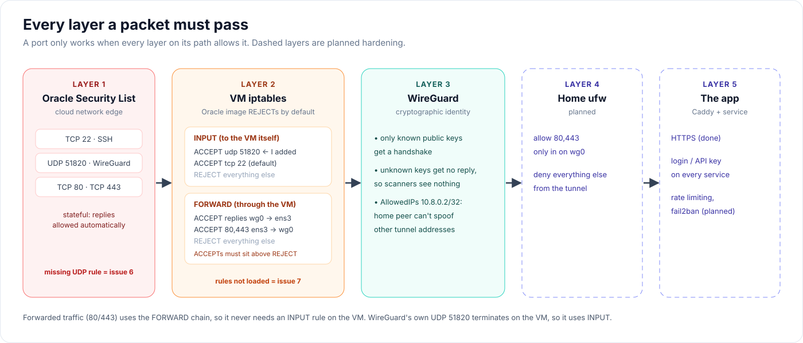

# 7. Security notes

Putting a home machine on the public internet changes its threat model. These are the protections in place and the ones still to add.

## What's in place

| Control | Where | Effect |
|---|---|---|
| Key-based WireGuard | both peers | No passwords. Unknown keys get no response, so the port looks closed to scanners. |
| `AllowedIPs` per peer | hub | The home peer can only use `10.8.0.2`. |
| Narrow forwarding | hub `FORWARD` chain | Only TCP 80/443 is forwarded. The home server can't open new connections out through the hub; only replies pass. |
| Two firewalls | Security List + iptables | A mistake in one layer is caught by the other. |
| Private keys root-only | `umask 077`, `chmod 600` | Keys aren't readable by other users and never left the machines. |
| HTTPS everywhere | Caddy | Logins and tokens aren't sent in plain text. |
| Budget alerts | Oracle billing | Surprise charges show up early. |

## What scanners did

Within minutes of the reboot test, the DNAT rule had already counted packets that I didn't send. Public IPs are scanned constantly. Assume anything forwarded will be probed the same day.

## Rules I follow now

1. **Never forward SSH (22)** on the hub. That would hand the VM's own SSH to the home box and could lock me out. If I need SSH to the home server from outside, I'll forward a different port (for example 2222 → 10.8.0.2:22) and use key-only auth, or reach it privately over the tunnel instead.
2. **Every exposed app gets its own authentication.** The tunnel protects the path, not the app.
3. **No test servers left running.** `python3 -m http.server` as root was for one test only.
4. **Secrets never go in Git or screenshots.** `.gitignore` blocks `*.key`, `privatekey` and real `wg0.conf` files. The DuckDNS token was rotated after it showed up in a screenshot.
5. **Configs in this repo use documentation IP ranges** (`203.0.113.0/24`, `198.51.100.0/24`, `192.0.2.0/24`) and placeholders instead of the real addresses.

## Still to do

- `ufw` on the home server allowing 80/443 only from `wg0`.
- `fail2ban` or Caddy rate limiting for anything with a login.
- Unattended security upgrades on both machines.
- Logging and alerting on the hub (for example, an alert when the handshake is older than five minutes).
- Moving SSH on the hub to key-only plus a non-default port, or reaching it only over WireGuard.

Next: [8. Operations](08-operations.md)
