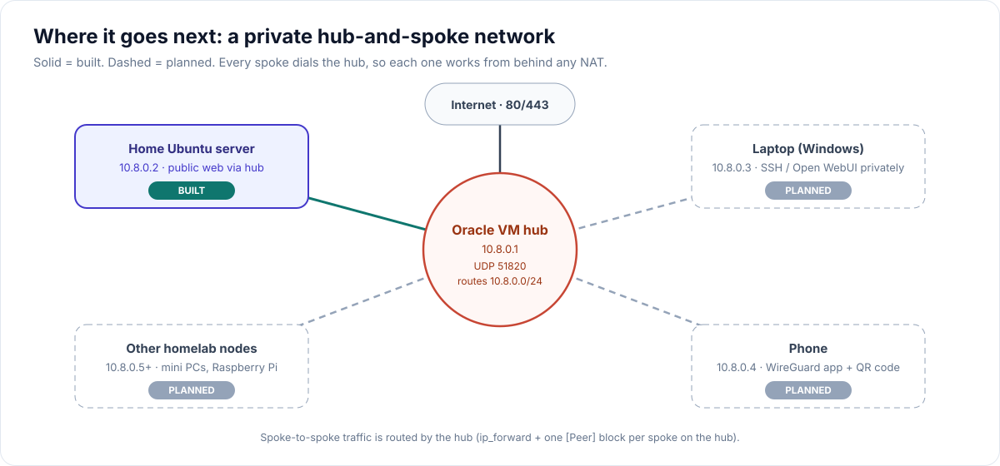

# 8. Operations: checks, changes, and what's next

## Health checks

Two scripts run the same layer-by-layer checks used during debugging:

```bash
sudo ./scripts/verify-hub.sh                                   # on the Oracle VM
sudo DOMAIN=your-subdomain.duckdns.org ./scripts/verify-home.sh  # on the home server
```

The hub script checks the interface, handshake age, the UDP INPUT rule, `ip_forward`, the DNAT and MASQUERADE rules, FORWARD rule order, and whether the backend answers through the tunnel. Each failure prints a hint pointing to the likely cause.

## Useful commands

| Task | Command |
|---|---|
| Tunnel status and last handshake | `sudo wg` |
| Restart after editing `wg0.conf` | `sudo systemctl restart wg-quick@wg0` |
| Show NAT rules with counters | `sudo iptables -t nat -L -n -v` |
| Show FORWARD rule order | `sudo iptables -L FORWARD -n --line-numbers` |
| Watch WireGuard packets | `sudo tcpdump -ni ens3 udp port 51820` |
| Watch web traffic on both sides of the hub | `sudo tcpdump -ni any tcp port 80 or tcp port 443` |
| Caddy logs | `sudo journalctl -u caddy -f` |

## Reboot test

Reboot both machines, one at a time, then check that the tunnel and rules came back without manual steps:

```bash
ping -c 3 10.8.0.1                             # home server
sudo iptables -t nat -L -n -v                  # hub: DNAT + MASQUERADE present
sudo iptables -L FORWARD -n --line-numbers     # hub: ACCEPTs above REJECT
```

This passed: `systemctl enable` starts `wg-quick@wg0` at boot, and `PostUp` re-creates the rules.

## Forwarding another port

1. Add the port to the `--dports` list in all four forwarding lines (`PostUp` and `PostDown`) of the hub's `wg0.conf`.
2. Add an ingress rule for it in the Oracle Security List.
3. `sudo systemctl restart wg-quick@wg0`.

Don't forward 22 (see [security notes](07-security-notes.md)).

## Roadmap

- [x] Phase 1: WireGuard tunnel through CGNAT
- [x] Phase 2: public 80/443 forwarded to the home server
- [x] Phase 3: DuckDNS domain + automatic HTTPS with Caddy
- [x] Reboot test
- [ ] Hub-and-spoke: add laptop (`10.8.0.3`) and phone (`10.8.0.4`) as peers for private access from anywhere
- [ ] Put real services behind Caddy (Team Ops MCP, Open WebUI) with authentication
- [ ] Hardening items from the security notes
- [ ] Get an A1.Flex (up to the Always Free total of 2 OCPU / 12 GB) once capacity is available; `scripts/oracle-a1-retry.sh` is running for this
- [ ] Terraform for the Oracle side (VCN, security list, instance)


